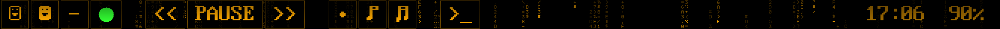
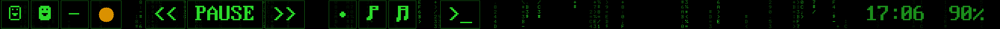
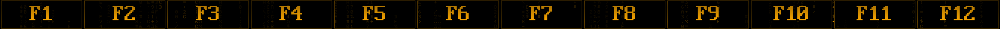

# Hacker Touchbar

> [!WARNING]
> This code and its documentation were written by AI and have only been tested
> briefly on one machine. Use it at your own risk, especially since it runs as
> root. This is a personal project: don't expect much follow-up on issues or
> pull requests.

A retro terminal for the Touch Bar on Intel MacBooks with a T2 chip running
Linux: your own row of keys over falling code, in amber or green phosphor, with
F1-F12 under Fn.




Hold Fn for the F keys:



Nederlandstalige handleiding: [docs/HANDLEIDING.md](docs/HANDLEIDING.md).

This is a fork of [touchbar-fx](https://github.com/Buku313/touchbar-fx) by
Buku313, reworked into a daily driver. See [Changes from
touchbar-fx](#changes-from-touchbar-fx) and [License](#license).

## Features

- **Key row:** your own buttons, grouped and spaced as you like, over an animation
  running across the whole bar. Choose `matrix` (slow falling code), `life`
  (Conway's Game of Life, computed live) or `stars` (slow starfield).
- **Terminal look:** one phosphor color, scanlines, square cells, reverse video
  on press, DOS code page 437 symbols. Pick `amber` or `green` from the bar.
- **Fn:** hold Fn for F1-F12. Keys are real key events, so holding and combos
  work.
- **Your own keys:** the row comes from the config file.
- **Bar brightness:** a key switches between full and dim and remembers it.
- **Background service:** starts when you log in, stops around suspend, and
  hands the bar back to tiny-dfr when it stops.

## Requirements

Tested on one machine so far:

| | |
|---|---|
| Hardware | MacBookPro16,2 (13", 2020), 2008-pixel bar |
| OS | Ubuntu 26.04 from [t2linux](https://wiki.t2linux.org), GNOME on Wayland |
| Kernel | 7.3.1-2-t2 |

The 2170-pixel bar of the 15"/16" models is accepted by the code but untested.
The service is written for systemd; audio goes through PipeWire or PulseAudio.

You need a working Touch Bar first: install `tiny-dfr`, reboot, and check that
it shows keys. Then install the build dependencies:

```sh
sudo apt install cmake pkg-config libdrm-dev libpulse-dev libdbus-1-dev \
    libfftw3-dev libevdev-dev zlib1g-dev
```

## Install

```sh
git clone https://github.com/sebastius/hacker-touchbar
cd hacker-touchbar
./install.sh
```

Run it as your normal user; it asks for sudo where needed. It builds the
program, installs the service and the suspend hook, and creates
`~/.config/touchbar-fx/config.toml` if you don't have one.

To remove it again, which gives the bar back to tiny-dfr:

```sh
./install.sh uninstall
```

## Using it

| Action | Result |
|---|---|
| Tap a key | It sends that key; hold for repeat |
| `PLAY` / `PAUSE` key | Play or pause; follows the current player (any MPRIS player) |
| Hold Fn | F1-F12 |
| Colored dot key | Switch to the theme of that color, remembered |
| `▬` / `_` key | Full or dim bar, remembered |

A `deck` mode with a play/pause key, a volume meter and a music visualizer is
still in the code. Set `order = ["deck"]` under `[modes]` to use it; a quick tap on
Fn then brings up the key row.

## Configuration

Everything lives in `~/.config/touchbar-fx/config.toml`, starting from
[config.example.toml](config.example.toml). No sudo needed to edit it. Apply
changes with:

```sh
sudo systemctl restart touchbar-fx
```

A control key looks like this:

```toml
[[controls]]
label = "LOCK"
keys = ["LEFTMETA", "L"]   # Linux key names without KEY_
width = 200                # optional minimum in pixels
```

Key names are in `/usr/include/linux/input-event-codes.h`. Use `show = "bar"`,
`"theme"`, `"playpause"`, `"clock"` or `"battery"` instead of `label` and `keys`
for the special buttons. `playpause` shows PLAY or PAUSE depending on the player.

Keys size themselves to their label and pack to the left; a clock or battery at
the end of the row moves to the right edge. Labels can use the DOS smileys from
code page 437: `"\u0001"` (outline) and `"\u0002"` (filled), the bullet
`"\u0007"`, the music notes `"\u000D"` and `"\u000E"`, and the thick bar
`"\u0016"`.

`key_background = "matrix"` under `[ui]` runs an animation behind the keys, dimmed
inside them so labels stay readable. Leave it out for a black row. It doesn't react
to music.

Spacing is yours to set. `key_gap` under `[ui]` is the space between all keys, 0
to 40 pixels. A gap between groups is an entry of its own, and `blink = true`
makes the last character of a label blink like a cursor:

```toml
[[controls]]
show = "gap"
width = 60      # pixels, default 40

[[controls]]
label = ">_"
keys = ["LEFTCTRL", "LEFTALT", "T"]
blink = true
``` A wrong key name skips that button and logs why.

Keys can only send keystrokes. To launch a program, bind a GNOME shortcut to it
and let the key send that shortcut.

The theme and brightness you pick on the bar are stored next to the config, in
`theme` and `bar-brightness`. A saved theme wins over `[ui] theme`.

## Troubleshooting

```sh
systemctl status touchbar-fx
journalctl -u touchbar-fx -b --no-pager -n 40
```

- **`No Touch Bar DRM device found`:** check that tiny-dfr works on its own.
  `appletbdrm` must be loaded and the bar must be in display mode, which
  tiny-dfr's udev rules take care of. A reboot after installing tiny-dfr may
  be needed.
- **Bar stays dark after waking up:** `sudo systemctl restart touchbar-fx`.
- **Fn does nothing:** look for `Fn key: watching internal keyboard` in the log.
- **Back to tiny-dfr for now:** `sudo systemctl stop touchbar-fx`. To keep it
  that way: `sudo systemctl disable --now touchbar-fx`.

## Security

The program runs as root, because it needs DRM master on the Touch Bar. It reads
the internal keyboard to spot Fn; other keys are not stored, they only cancel a
Fn tap. Compared to touchbar-fx:

- The HTTP bridge on port 8323 is off. It had no authentication and accepted
  requests from any website.
- In the optional `mediacenter` mode, cover art is downloaded and decoded as your
  own user instead of root.

## Development

No hardware needed for most work:

```sh
cmake -B build && cmake --build build
./build/touchbar-fx-test
./build/touchbar-fx --dump-frames 300 --null-audio --dump-mode controls \
    --out /tmp/frames --width 2008 --height 60
```

Adding an animation is one file in `src/viz/presets/` with a `REGISTER_PRESET`
line, then set `key_background` to its name in the config.
[docs/HANDLEIDING.md](docs/HANDLEIDING.md) has a worked example, in Dutch.

```
src/mode/      key rows, deck, original media center
src/viz/       renderer core and presets
src/widget/    widgets and layout
src/input/     touch, Fn watcher, virtual keyboard
src/gfx/       framebuffer, font, themes
systemd/       service template and suspend hook
```

## Changes from touchbar-fx

- Added: key row as the main bar, deck mode, `matrix`, `life` and `stars`, amber and green terminal
  themes, Fn layers, configurable control row, bar brightness key, `install.sh`, a
  general service and suspend hook.
- Fixed: the 2008-pixel bar of the 13" models is now detected, and the program
  no longer hangs on exit while no audio plays.
- Removed: the Pioneer clip preset, the penguin preset and the old
  machine-specific scripts. The penguin sprites came from someone else's video,
  so their rights are unclear.

## License

**The original touchbar-fx has no license, so no license applies to this fork
either.** You can view and fork it on GitHub under GitHub's terms, but it gives
you no clear permission beyond that. New code in this fork can't be relicensed
separately until the original author picks a license.

`third_party/toml.hpp` is [toml++](https://github.com/marzer/tomlplusplus), MIT
licensed.
