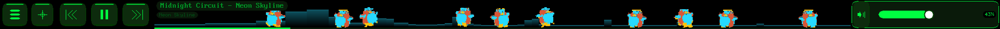

# touchbar-fx

A userspace daemon that turns the Apple Touch Bar on T2 Macs running
Linux into a little media center with visualizers. It talks to the
touch bar's DRM device directly (appletbdrm, dumb buffers, page
flips), reads touch input with libevdev, captures system audio from
the PipeWire/PulseAudio monitor, and follows whatever is playing over
MPRIS.



## What it does

- Media center layout: transport buttons (prev / play / next), a
  visualizer zone with track, artist and album overlay, a seek strip
  you can drag, and a volume slider.
- Album art: on every track change the daemon fetches the player's
  `mpris:artUrl`, downsamples the cover, shows it in the corner, and
  recolors the whole bar (buttons included) from the cover's two
  dominant colors. Works with any MPRIS player: Spotify, YouTube in a
  browser, VLC. Tap the cover thumbnail to toggle between the cover
  colors and your own picks.
- Color picker mode: two hue sliders for your own main/accent scheme,
  with a white option at the top of the range.
- Visualizer presets:
  - `pioneer`: plays real Pioneer carrozzeria OEL animation clips
    (`.lkd` data from the old head units), side by side at native
    aspect, 14 fps with a loudness speedup. Tap a panel to focus it
    over a stretched backdrop. Includes the level indicators driven
    by the actual frequency bands.
  - `penguin`: a flock of dancing penguins. They loiter when idle
    (and occasionally high five or pop hearts between them), and go
    feral with music: an 808 detector in the low band launches the
    flock on bass hits, big hits trigger belly slides, collisions
    knock them around.
  - `dolphins`: a 2D fishtank with procedurally animated dolphins,
    breaches and splashes on beats.
  - `spectrum`: Pioneer style segmented analyzer with peak hold.
  - `waves`, `oscilloscope`: spectrum bars and waveform with feedback
    trails.
- Themes: `default` (neon green) and `oel` (Pioneer cyan). The oel
  theme retints live to follow the album art or slider hues.
- A matching spicetify theme for Spotify itself in `spicetify/`.

## Requirements

- A T2 MacBook (2016-2019 Touch Bar models) running Linux with the
  touchbar driver stack from the t2linux project (`apple_bce`,
  `appletbdrm`). If `tiny-dfr` works, this works.
- Build deps: cmake, libdrm, libpulse (+ libpulse-simple), dbus-1,
  fftw3, libevdev, zlib.
- Runtime: `curl` and ImageMagick (`magick`) for album art fetching.

## Build and install

```sh
cmake -B build
cmake --build build
sudo cmake --install build
```

Run it as root (the daemon needs DRM master; it stops tiny-dfr while
running and restarts it on exit):

```sh
sudo touchbar-fx --debug
```

`systemd/` has a boot watchdog and a suspend/resume hook for the
times the touch bar loses its USB probe race or comes back black
from sleep. Install them by hand if you want them.

## Controls

- Tap mode button (≡): home. Long-press: next mode.
- Tap ✦: next visualizer preset. Long-press in pioneer: next page.
- Tap a pioneer panel: focus that clip, tap again to go back.
- Tap the album cover: toggle bar colors between cover and custom.
- Drag the center zone: seek. Drag the right zone: volume.
- `touchbar-fxctl`: `cycle`, `mode <name>`, `preset <name>`,
  `hue <main> <accent>`. Same commands over HTTP on 127.0.0.1:8323
  for clients that cannot reach the unix socket.

## Config

`~/.config/touchbar-fx/config.toml`, all keys optional:

```toml
[modes]
order = ["mediacenter", "colors", "sliders"]

[ui]
theme = "oel"

[visualizer]
preset = "penguin"
rotate_seconds = 0

[dump]
width = 2170
height = 60
```

## Pioneer clips

The `.lkd` clip data is Pioneer property and not distributed here.
Drop clips into `assets/clips/` (or `/usr/local/share/touchbar-fx/clips/`)
and they show up as panels, grouped into pages by filename prefix
(`movie*`, `bgv*`, `li_*` for the level indicators, anything else).

Make your own clips from any video with ffmpeg and Python:

```sh
tools/lkd_encode.py input.mp4 -o myclip.lkd
```

## Development

No hardware needed for most work:

```sh
./build/touchbar-fx-test                                  # unit tests
./build/touchbar-fx --dump-frames 300 --null-audio \
    --out /tmp/frames --width 2008 --height 60            # render to BMPs
```

There is also an optional SDL2 window backend:
`cmake -B build -DTOUCHBAR_FX_SCREEN=ON`.

## Layout

```
src/engine/    epoll loop, dirty-coalescing scheduler
src/drm/       touch bar DRM device and output
src/gfx/       framebuffer, font, theme
src/viz/       renderer core (FFT, beat detect) + presets in presets/
src/media/     MPRIS client, album art fetcher and color analysis
src/audio/     PipeWire monitor capture, synthetic test source
src/widget/    widget base, layout engine, builtin widgets
src/mode/      modes: mediacenter, sliders, colors
src/ipc/       unix socket server, HTTP bridge, touchbar-fxctl
src/input/     touch via libevdev (tap, long-press, drag)
spicetify/     matching Spotify theme
systemd/       boot watchdog, suspend/resume hook
tools/         lkd encoder, penguin sprite extractor
```
